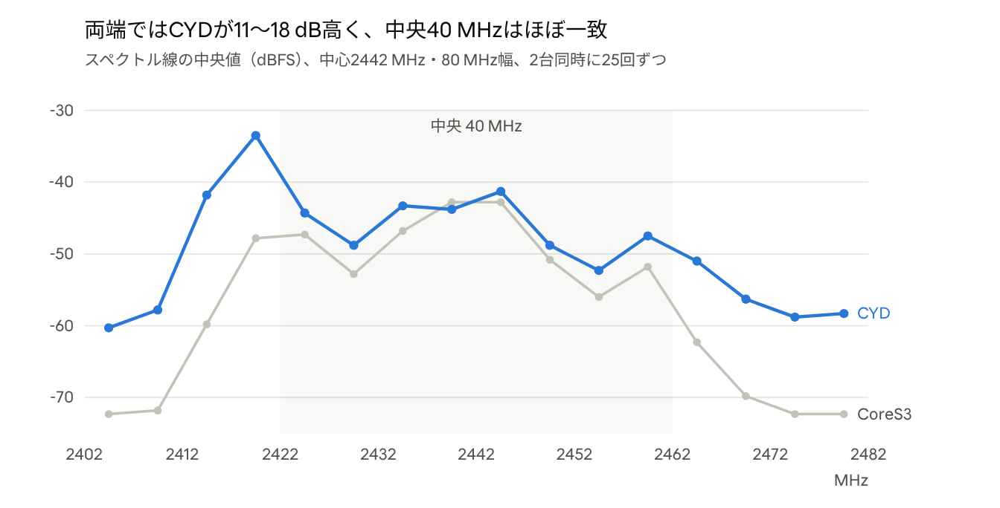

# esp-sdr LCD表示：ESP32-S3と無印ESP32の違い

2026-10-22

## 概要

CYD（ESP32-2432S028R、無印ESP32）のLCD表示は、コミット `808964c` で中央40 MHzの信号レベルがCoreS3（ESP32-S3）と1〜3 dBの差に揃いました。修正前は、40 msの更新で約0.2 msしか電波を見ておらず、値もFFT 1本ごとのピークだったため、CoreS3と見え方が大きく違っていました。

- 無印ESP32は連続取り込みができず、CPUも遅いため、S3と同じ方式はそのまま使えません。
- 修正後も、画面の両端（ch1付近・ch13付近）はCYDが11〜18 dB高く出ます。これはCoreS3側の受信部が両端で感度を落とすためで、CYDの不具合ではありません。
- ノイズフロアは基板の差で約4 dB高いまま残ります。

## S3と無印ESP32の違い

いちばん大きい違いは取り込み方式です。S3は受信した電波を途切れなく処理できますが、無印ESP32は0.2 ms分を取り込んでは処理する、の繰り返しです。下の表の数値は、中心2442 MHz、80 MS/s、2台を同じ場所に置いて測った実測です。

| 項目 | CoreS3（ESP32-S3） | CYD（無印ESP32、修正後） |
| --- | --- | --- |
| 取り込み方式 | リングバッファで連続取り込み（`ring_capture`） | 16128サンプル（約0.2 ms）のスナップショットを繰り返す |
| FFT | 専用命令で高速。取り込んだ区間をすべてFFT | 専用命令なし。256点FFT 1本に約0.2 ms（IRAM実行時） |
| 表示用フレーム | 1ユニット（約64本のFFT）の平均電力 | 取り込み1回から等間隔に16本のFFTの平均電力 |
| 40 msの更新あたりのフレーム数 | 約82〜88 | 約10 |
| 画面の値 | フレームのビンごとのピーク、直近3回の中央値 | 同じ（描画コード `main/lcd/lcd_view.c` は共通） |
| 両端（中心±20 MHzより外）の感度 | 落ちる | あまり落ちない |
| ノイズフロア | 約−69 dBFS | 約−65〜−66 dBFS |
| ゲイン初期値 | 35（調整済み） | 35（ESP32では未評価） |

ノイズフロアの差は、平均の本数を16〜63本のどれにしても変わらなかったため、基板（受信部やADC）の差と考えています。

## 計測で分かったこと

修正前のCYDは、40 msの更新を取り込み1回（0.2 ms）だけで使い切っていました。取り込んだ区間を63本すべてFFTしていたうえ、FFTも取り込みも想定より大幅に遅かったためです。各処理の時間は、仮の計測コードを入れて実機で測りました。

| 処理 | 修正前 | 修正後 | 原因と対応 |
| --- | --- | --- | --- |
| FFT 1本（256点） | 約0.70 ms | 約0.20 ms | フラッシュ上で実行され、キャッシュが効いていなかった。IRAMに置いた |
| 窓掛け・電力変換など（FFT 1本あたり） | 約0.13 ms | 約0.10 ms | 同上 |
| 取り込み1回 | 約1.27 ms | 約0.26 ms | 約0.9 msは64 KB全体の書き込み確認。LCD用は境界の数ワードだけ確認する |
| うち実際の取り込み | 約0.20 ms | 約0.20 ms | 16128サンプル ÷ 80 MS/s |
| 40 msあたりの取り込み回数 | 1回 | 約10回 | 16本の平均にしたため |

- 修正前は、Wi-Fiのパケット（数百µs〜数ms、ビーコンは約100 msおき）にたまにしか当たらず、信号が低く、ウォーターフォールもまばらに見えていました。
- ウォーターフォールの履歴は60行すべて確保できていて、メモリ不足は原因ではありませんでした。
- ゲインを0〜72で振ると、近くのアクセスポイントの電波はゲイン30〜40でもADCの上限に届くことがありました。Wi-Fiの通信量で毎回値が大きく変わるため、CYD単体の測定だけではゲインの差を決められず、2台同時の比較で判断しました。

## 変更内容（コミット 808964c）

CYDの表示用フレームを、S3と同じ「取り込み区間の平均電力」に揃えました。変更は `main/targets/esp32/receiver.c` の `lcd_capture` と `acquire_iq` です。

1. 取り込み1回から等間隔に16区間を256点FFTし、その平均電力を1フレームとして渡す（`LCD_MEANS 16`）。
2. `lcd_capture` をIRAMに置く（`IRAM_ATTR` と `noinline`。`noinline` がないとフラッシュ上の呼び出し元に展開され、効果がなかった）。
3. LCD表示用の取り込みだけ、書き込み確認を最終サンプル付近に絞る（`acquire_iq` の `spot` 引数）。PC側のコマンド（SPEC、IQ取り込み）は従来どおり全体を確認する。
4. README（英語・日本語）と `main/lcd/lcd_view.c`、`lcd_view.h` の説明を新しい方式に合わせる。

平均の本数は、2台を同時に測って決めました（各本数で15回ずつ `LCDDUMP?`、単位はdBFS）。

| CYDの平均本数 | フレーム/更新 | 線の最大値 CYD / CoreS3 | ピーク CYD / CoreS3 | ノイズフロア CYD / CoreS3 |
| --- | --- | --- | --- | --- |
| 1（修正前と同じ考え方、最も強い区間） | 約59 | −22.5 / −30.5 | −12.5 / −29.8 | −64.0 / −69.0 |
| 16（採用） | 10 | −30.8 / −30.3 | −27.3 / −26.8 | −65.8 / −69.8 |
| 32 | 6 | −28.8 / −32.8 | −30.8 / −23.3 | −65.8 / −71.8 |
| 63（全区間） | 3 | −48.3 / −31.3 | −34.8 / −26.8 | −66.3 / −69.3 |

1行目だけは別の回の測定で、本数を変える前の方式（最も強い区間のFFT 1本）の値です。63本では更新あたり3フレームしか取れず、パケットを取りこぼして信号が低く出ます。16本が、信号レベルと取り込み回数の釣り合いが最もよくとれていました。

## CoreS3との比較結果

修正後、中央40 MHz（2422〜2462 MHz）の信号はCoreS3と−1〜+4 dBの差に収まりました。画面全体でCYDが10 dBほど高く見えるのは、両端20 MHzずつで差が11〜18 dBあるためです。

CYDとCoreS3に同時に `LCDDUMP?` を25回ずつ送って計測（2026-10-22、80 MHzを5 MHzごとの16区間に分割）。

| 指標（dBFS） | CoreS3 | CYD 修正前 | CYD 修正後 |
| --- | --- | --- | --- |
| 線の最大値 | −29.5 | −22.5 | −28.5 |
| ピーク | −25.8 | −12.5 | −28.3 |
| 線の中央値 | −61.3 | −52.4 | −58.0 |
| ノイズフロア | −69.3 | −64.0 | −65.3 |

修正前の列は別の回の測定で、そのときのCoreS3は順に−30.5、−29.8、−62.5、−69.0 dBFSでした。

## 残る違いと今後

残る違いはいずれも、ハードウェアの差か、無印ESP32の処理能力による制約です。コードで揃える対象とは考えていません。

- **両端の感度:** CoreS3は中心から±20 MHzを超えると感度が落ちます（READMEの「両端（およそ ch1 以下と ch13 以上）は感度が落ちます」）。CYDはあまり落ちないので、端の電波はCYDのほうが実態に近い可能性が高いです。
- **ノイズフロア:** CYDが約4 dB高いままです。ゲインを下げると信号も下がるので、ゲインは35のままです。
- **取りこぼし:** CYDは40 msあたり約10回の取り込みで、CoreS3の約85フレームより短い信号を見逃しやすいです。
- **ウォーターフォールの色:** 色の基準はスペクトル線の中央値に追従します。そのため両端が高いCYDは−70、CoreS3は−80 dBFSとずれています。

未対応の候補：

- [ ] READMEのCYDの説明に「両端の感度がS3ほど落ちない」と書き足す
- [ ] 見た目を合わせるなら、CYDの受信フィルタを狭めて両端を下げる（ch1・ch13の電波は見えにくくなる）
- [ ] ESP32でのゲイン初期値（35）を、安定した信号源で評価する
